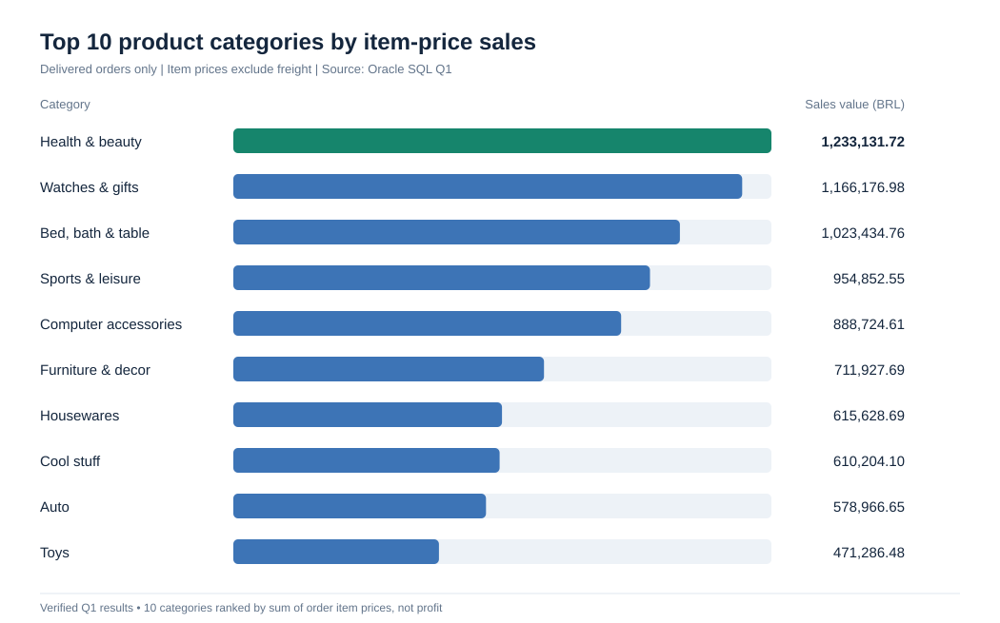
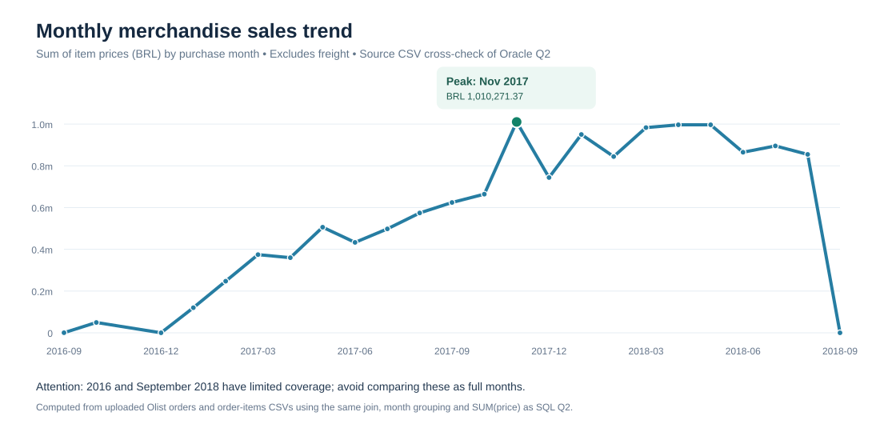
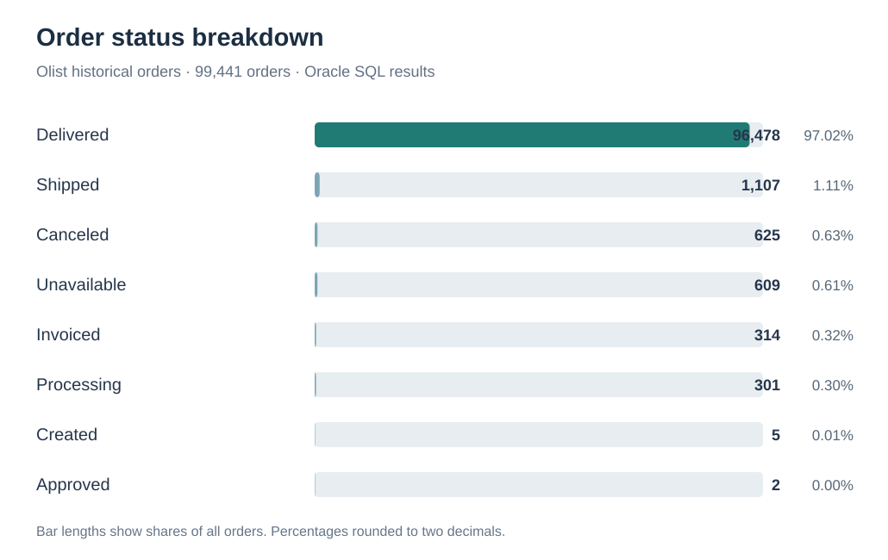
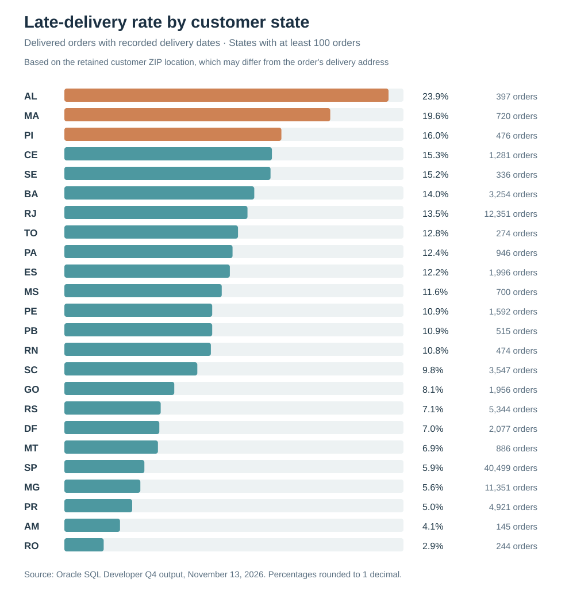
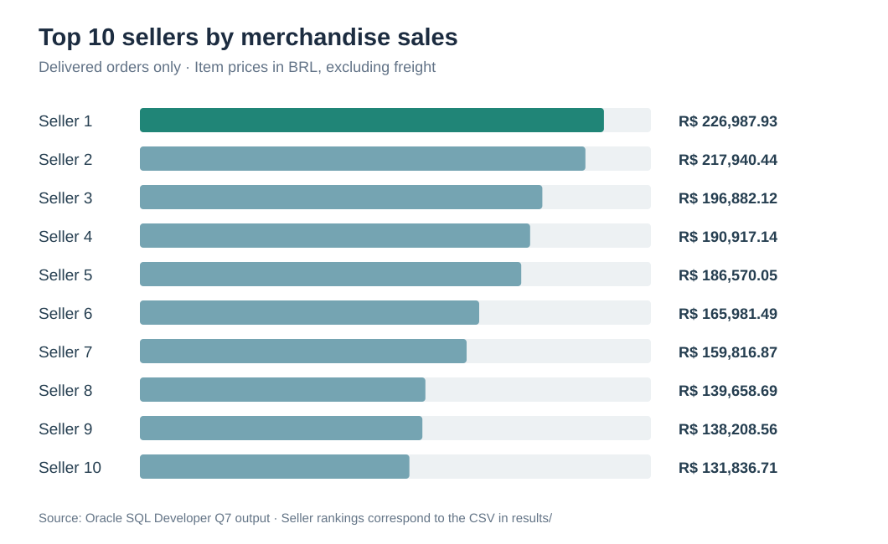
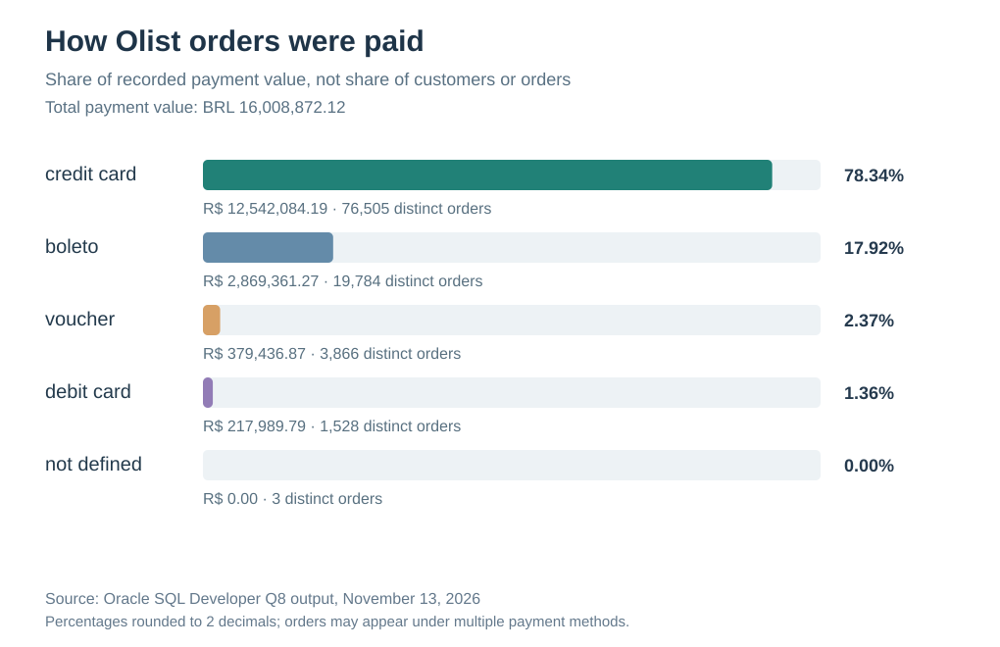
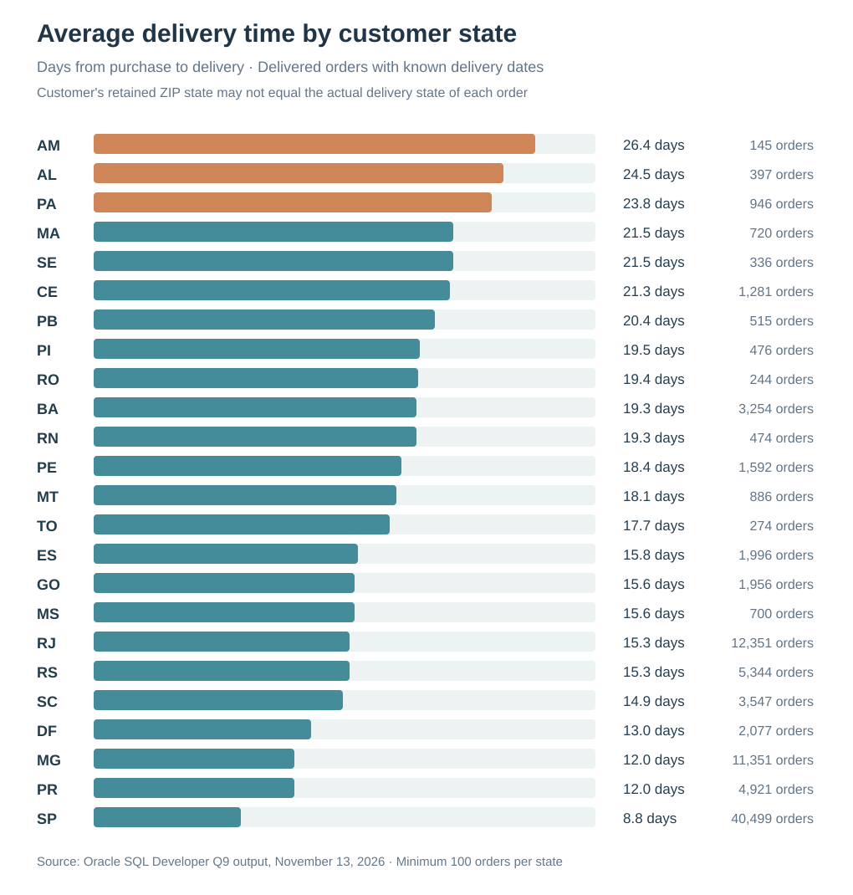
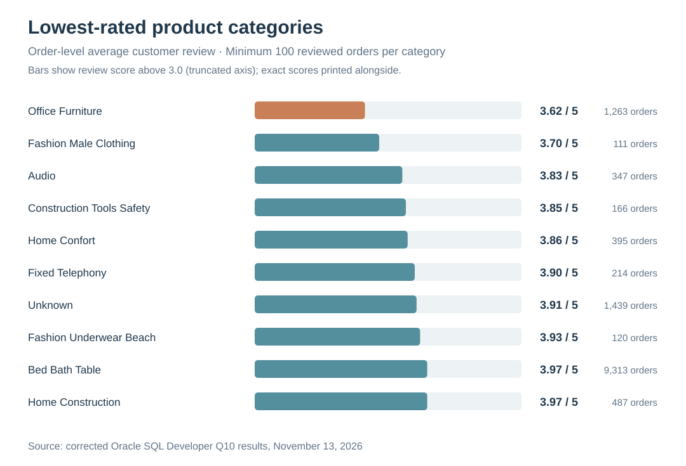
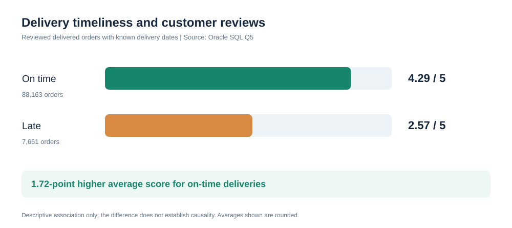
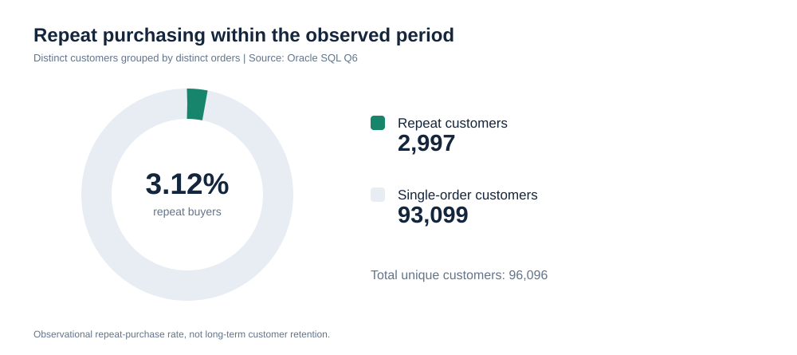

# Olist E-Commerce Database & Customer Analytics

This project looks at how delivery performance, customer purchasing habits, and product sales shape the online shopping experience. Using the Olist Brazilian E-Commerce dataset, I built a relational database in Oracle, cleaned and checked the data, and wrote SQL queries to answer practical business questions. I also used Python to check query results and create charts that make the findings easier to follow.

The dataset covers Brazilian online orders from 2016 to 2018. I started this as a Database Management Systems project and am extending it into a data analytics portfolio project. The Oracle database and data-quality checks are complete, and all ten core SQL business analyses have now been run and checked.

## What I wanted to find out

- Do orders delivered after their estimated date receive lower review scores?
- How often do customers place another order?
- Which product categories account for the most merchandise sales?
- How do order volume and sales change over time?
- Where do delivery outcomes differ across customer-location states?

## Findings so far

**Late deliveries and reviews.** The 7,661 late orders in the reviewed-delivery sample received an average score of **2.57/5**, compared with **4.29/5** for 88,163 on-time orders. That's a **1.72-point gap** using the rounded averages. The difference is an association, not proof that delays caused lower scores.

**Repeat purchases.** Out of **96,096** unique customers in the orders data, **2,997** placed more than one order (**3.12%**). This is the observed repeat-purchase rate during the dataset's time window, not a lifetime retention rate.

**Product category sales.** **Health & Beauty** led delivered-order merchandise sales with **BRL 1,233,131.72** in item prices. Bed, Bath & Table had more distinct orders than Health & Beauty but a smaller sales total. These totals exclude freight and do not represent profit.

**Monthly sales.** November 2017 had the highest monthly item-price sales in Q2: **BRL 1,010,271.37** across **7,451** orders. I compared all 24 monthly rows from Oracle with the chart dataset in Python; the comparison passed.

**Order status.** Out of **99,441** recorded orders, **96,478 (97.02%)** were marked as delivered. The rest were listed as shipped, canceled, unavailable, invoiced, processing, created, or approved. A delivered status doesn't guarantee every delivery date is present; eight delivered orders have no recorded actual delivery timestamp.

**Late deliveries by state.** Alagoas (AL) had the highest late-delivery rate in the Q4 analysis (**23.9%**) among customer-location states with at least 100 delivered orders and recorded delivery dates. These state assignments use each customer's retained ZIP prefix and may not match the address on every order.

**Top sellers.** The leading seller recorded **BRL 226,987.93** in item-price sales across **1,124** delivered orders, with an average review score of **4.15** across **1,116** reviewed orders. Among the ten highest-selling sellers, the fourth-ranked seller had the highest average review score (**4.37**). Ratings are associated with orders involving each seller and may reflect other sellers in the same order.

**Payment methods.** Credit cards accounted for **78.34%** of recorded payment value (BRL 12,542,084.19), followed by boleto at **17.92%**. These are shares of payment value, not shares of customers or unique orders.

**Delivery duration by state.** Amazonas (AM) had the longest average purchase-to-delivery time (**26.4 days**) among states with at least 100 eligible delivered orders; São Paulo (SP) had the shortest (**8.8 days**). State groupings reflect each customer's retained ZIP prefix, not necessarily each order's original shipping address.

**Lowest-rated categories.** Office furniture had the lowest average order review among the ten lowest-rated eligible categories (**3.62/5**, based on **1,263** reviewed orders). I corrected the original item-weighted query so each order contributes only once per category before comparing scores.

The detailed query outputs, methods, and caveats are in the [findings report](results/FINDINGS_REPORT.md).

## Visualizations

### Product category sales

### Monthly merchandise sales

### Order status distribution

### Late-delivery rates by customer state

### Top sellers by merchandise sales

### Payment methods

### Average delivery time by customer state

### Lowest-rated categories

### Delivery time and review scores

### Repeat purchases

## Next: Understanding SQL query performance

I am now investigating how Oracle chooses execution plans for monthly sales queries. The [Phase 6 experiment](results/PERFORMANCE_EXPERIMENT.md) compares two equivalent date filters before making any new index changes. Results are pending, so I am not claiming a performance improvement yet.

## How I built the database

I created a nine-table relational model for customers, locations, sellers, products, product categories, orders, order items, payments, and reviews. The source CSVs were imported into staging tables first. From there, SQL transformations loaded the final tables and handled details such as unique customers and ZIP-code prefixes.

I checked the resulting tables before starting the analysis. All **nine** final-table counts matched the expected counts calculated from the staging data. Oracle also reported **nine enabled and validated primary keys** and **nine enabled and validated foreign keys**. The additional checks found no duplicate order IDs, no orphan order items/payments/reviews, and no review scores outside the 1–5 range.

One issue remains documented: **eight orders marked as delivered have no actual delivery timestamp**. I excluded records without the required timestamps from delivery-timeliness comparisons rather than treating them as on-time or late.

See the [ER diagram](diagrams/ER_DIAGRAM.md) and [data quality report](results/data_quality_report.md) for the design and validation details.

## Tools and project files

| File or folder | Purpose |
|---|---|
| [`oracle/01_schema.sql`](oracle/01_schema.sql) | Final tables, keys, and indexes |
| [`oracle/02_staging_tables.sql`](oracle/02_staging_tables.sql) | Raw-data staging tables |
| [`oracle/03_load.sql`](oracle/03_load.sql) | Load and transform the source data |
| [`oracle/04_data_validation.sql`](oracle/04_data_validation.sql) | Check counts, constraints, duplicates, and missing values |
| [`oracle/04_queries.sql`](oracle/04_queries.sql) | Ten business questions written in SQL |
| [`oracle/05_performance_baseline.sql`](oracle/05_performance_baseline.sql) | Read-only query-plan experiment (Phase 6) |
| [`results/PERFORMANCE_EXPERIMENT.md`](results/PERFORMANCE_EXPERIMENT.md) | Performance experiment protocol and pending results |
| [`scripts/prepare_csv_for_oracle.py`](scripts/prepare_csv_for_oracle.py) | Prepare CSVs for Oracle import |
| [`results/FINDINGS_REPORT.md`](results/FINDINGS_REPORT.md) | Results and interpretation |
| [`results/data_quality_report.md`](results/data_quality_report.md) | Data checks and issues identified |
| [`visualizations/`](visualizations/) | Charts based on query results |
| [`diagrams/ER_DIAGRAM.md`](diagrams/ER_DIAGRAM.md) | Entity-relationship diagram |

**Tools:** Oracle Autonomous Database, Oracle SQL Developer, SQL, Python (pandas and Matplotlib), and GitHub.

## Reproducing the database

1. Download the [Olist Brazilian E-Commerce dataset](https://www.kaggle.com/datasets/olistbr/brazilian-ecommerce). This repository does not include the raw data.
2. Put the eight CSVs used in this project into `data/` and prepare them with `scripts/prepare_csv_for_oracle.py` (requires pandas).
3. In your own Oracle database/schema, run `oracle/01_schema.sql` followed by `oracle/02_staging_tables.sql`. **These setup scripts drop and recreate tables, so do not run them against a schema containing data you want to keep.**
4. Import the prepared CSVs into the matching staging tables using SQL Developer.
5. Run `oracle/03_load.sql` and then `oracle/04_data_validation.sql`.
6. Run the analyses in `oracle/04_queries.sql`. Compare the results with the reports and charts in this repository.

## Scope and limitations

This is a historical, single-marketplace dataset rather than live retail data. Item-price sales exclude freight and costs. The customer table retains one ZIP prefix per unique customer, so state-level analysis cannot always recover the address associated with each individual order. Some orders have incomplete delivery information. These limitations matter when interpreting the results.

## Data source

[Olist Brazilian E-Commerce Public Dataset (Kaggle)](https://www.kaggle.com/datasets/olistbr/brazilian-ecommerce). The original data remains attributed to its publisher.
