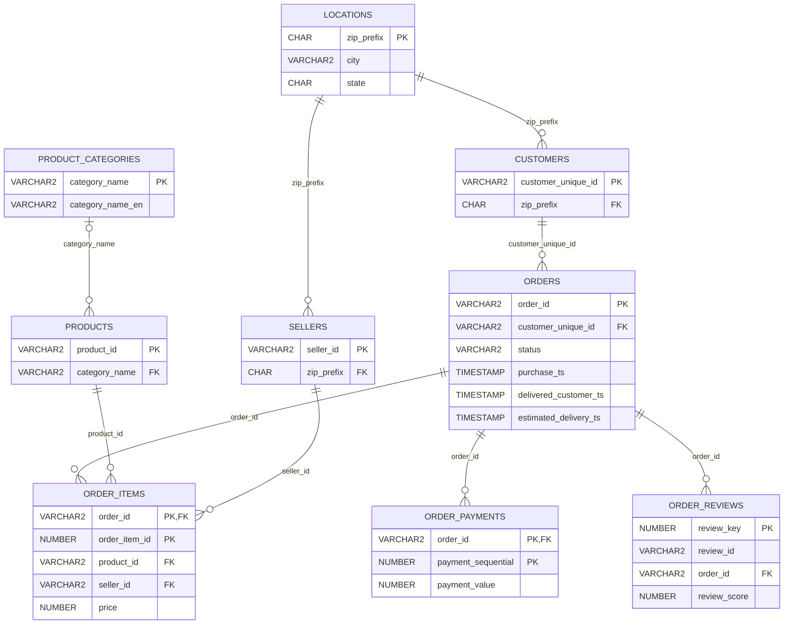

# Entity Relationship Diagram — Oracle 3NF Model

This diagram documents the relationships declared in `oracle/01_schema.sql`. GitHub renders the Mermaid diagram below.

**Modeling caveat:** The `customers` table keeps one ZIP prefix per unique customer (chosen from their latest order). Therefore, state-level delivery analysis uses that retained location rather than the historical address on each order. State-level findings should be labeled accordingly. The source dataset has a separate per-order `customer_id`; preserving that mapping in a future version would improve historical geographic accuracy.

**Execution status:** Diagram is derived from SQL definitions; Oracle execution and row-count validation remain pending.
