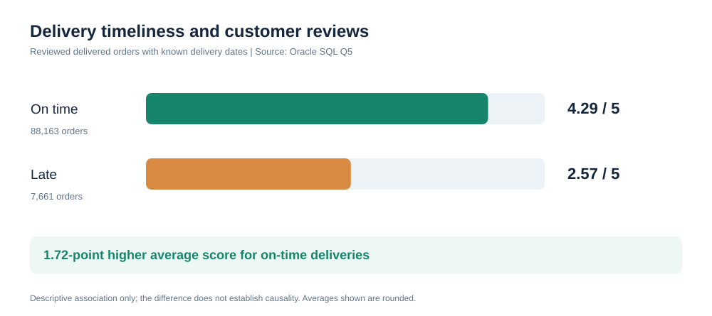
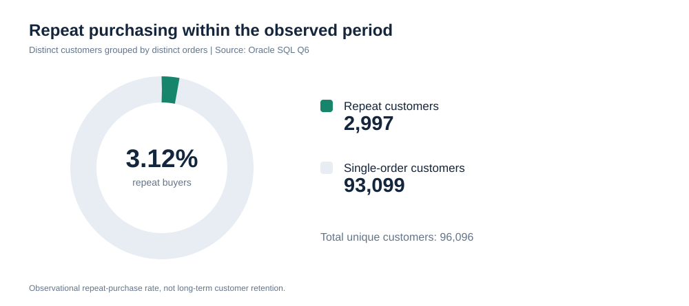
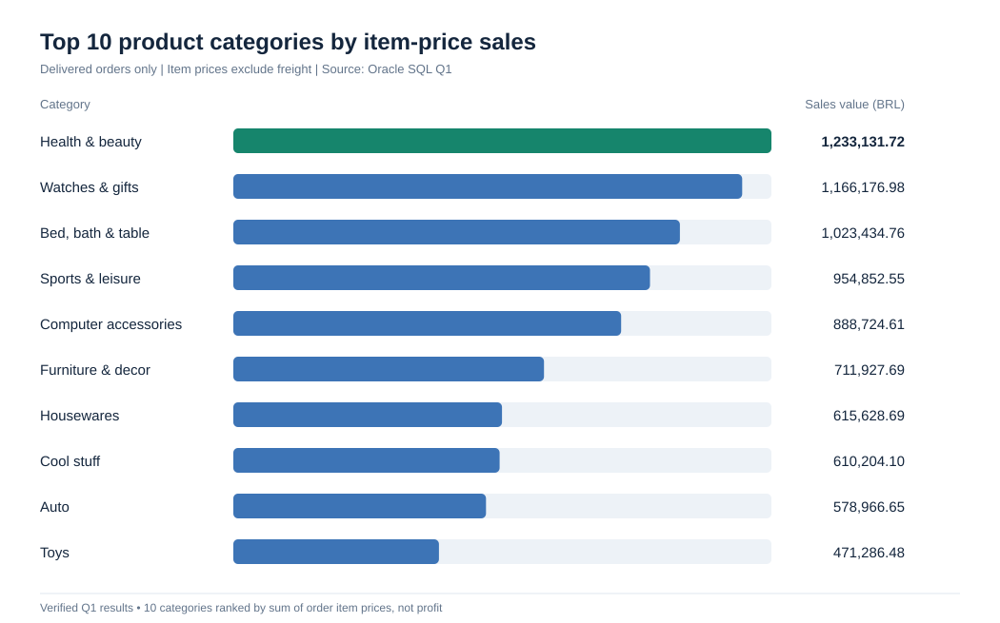
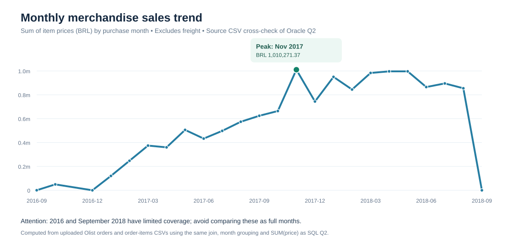

# Olist E-Commerce Customer Analytics — Findings Report

**Status:** In progress. Q1, Q5, and Q6 results verified from Oracle SQL Developer screenshots dated November 10, 2026. Other business-query results remain pending.

## Objective

Explore whether late delivery is associated with lower customer review scores and quantify repeat purchasing, regional delivery differences, and category revenue.

## Reproducibility checklist

- [x] Run `01_schema.sql` and `02_staging_tables.sql`
- [x] Import eight prepared CSV datasets into staging tables (counts reconciled in the data quality report)
- [x] Run `03_load.sql`; final-table row counts reconciled against staging-derived expectations
- [x] Check orphaned foreign keys and unexpected nulls (see `data_quality_report.md`; eight delivered-status records missing delivery dates flagged)
- [ ] Execute all ten queries from `04_queries.sql`
- [ ] Export result CSVs and capture SQL Developer screenshots
- [ ] Record the query date, Oracle version, and limitations

## Q5 — Relationship Between Delivery Performance and Customer Satisfaction

**Business Question:** Do orders delivered later than their estimated delivery dates receive lower customer review scores?

**Methodology:** Using Oracle SQL, delivered orders were classified as either late or on time by comparing their actual delivery timestamps with their estimated delivery timestamps. Orders without the required delivery dates or customer reviews were excluded. For orders with multiple reviews, the review scores were averaged to ensure each order contributed only once to the analysis. The reproducible query is [Q5 in `oracle/04_queries.sql`](../oracle/04_queries.sql).

**Results:** A total of **95,824 orders** were analyzed.

| Delivery status | Orders analyzed | Average review score (1–5) |
|---|---:|---:|
| Late | 7,661 | 2.57 |
| On Time | 88,163 | 4.29 |
| **Total** | **95,824** | **Not calculated in this query** |

**Key Finding:** On-time deliveries received an average review score **1.72 points higher** than late deliveries, based on the rounded group averages (**4.29 − 2.57 = 1.72**). Approximately **7.99%** of the included orders were late (**7,661 ÷ 95,824 × 100**).

**Business Implications:** The findings indicate a strong descriptive association between delivery timeliness and customer satisfaction. Delivery reliability may be an important area for e-commerce businesses to investigate when developing strategies to improve customer experience. Further analysis should account for other potential influences before attributing rating differences to delivery performance.

**Limitations:** This analysis demonstrates an association rather than a causal relationship. Other factors, including product quality, seller performance, and geographic location, may influence review scores. Additionally, the results apply only to reviewed, delivered orders with usable actual and estimated delivery timestamps. Multiple reviews for an order are averaged into one observation. The 1.72-point difference is calculated from group averages rounded to two decimals rather than from unrounded values.

**Verification:** Results transcribed from the project owner's Oracle SQL Developer `Olist_Project` / `Q5.sql` screenshot dated November 10, 2026.

## Q6 — Repeat Customer Behavior

**Business Question:** What percentage of unique Olist customers placed more than one order in the observed dataset?

**Methodology:** Group orders by `customer_unique_id` and count distinct `order_id` values per customer. Count a customer as a repeat customer if they placed more than one distinct order. Divide the repeat-customer count by the number of customers represented in the orders table. The reproducible query is [Q6 in `oracle/04_queries.sql`](../oracle/04_queries.sql).

| Total unique customers | Repeat customers (2+ orders) | Customers with 1 order | Observed repeat-purchase rate |
|---:|---:|---:|---:|
| 96,096 | 2,997 | 93,099 | **3.12%** |

**Key Finding:** **2,997 out of 96,096** unique customers placed more than one order (**2,997 ÷ 96,096 × 100 ≈ 3.12%**). The other **93,099** customers placed one order in the recorded period.

**Business Implications:** Repeat purchases were uncommon within the data's observation window. Investigating repeat behavior by customer cohort or product category may help identify patterns, but no specific retention improvement is established by this descriptive result.

**Limitations:** This is the *observed repeat-purchase rate*, not a lifetime customer retention rate. The dataset has a limited historical window (2016–2018), and customers near the end of the period have less time to make another purchase. The measure counts orders, not purchased items, and does not establish why customers did or did not return.

**Verification:** Values transcribed from the project owner's Oracle SQL Developer screenshot dated November 10, 2026; Q6 query results.

## Q1 — Top Product Categories by Merchandise Sales

**Business question:** Which product categories have the highest item-price sales total among delivered orders?

**Methodology:** Join `ORDER_ITEMS`, `ORDERS`, `PRODUCTS`, and `PRODUCT_CATEGORIES`. Restrict to orders whose status is `delivered`; group by translated product category; sum `ORDER_ITEMS.PRICE`; and count distinct orders per category. Rank by the sum of item prices and keep the top ten. Query: [Q1 in `oracle/04_queries.sql`](../oracle/04_queries.sql).

| Rank | Product category | Item-price sales total | Distinct orders |
|---:|---|---:|---:|
| 1 | health_beauty | 1,233,131.72 | 8,647 |
| 2 | watches_gifts | 1,166,176.98 | 5,495 |
| 3 | bed_bath_table | 1,023,434.76 | 9,272 |
| 4 | sports_leisure | 954,852.55 | 7,530 |
| 5 | computers_accessories | 888,724.61 | 6,530 |
| 6 | furniture_decor | 711,927.69 | 6,307 |
| 7 | housewares | 615,628.69 | 5,743 |
| 8 | cool_stuff | 610,204.10 | 3,559 |
| 9 | auto | 578,966.65 | 3,810 |
| 10 | toys | 471,286.48 | 3,804 |

**Finding:** `health_beauty` has the largest item-price sales total, while `bed_bath_table` has more distinct orders (9,272 versus 8,647) but a smaller sales total. The category ranking therefore differs from a simple order-count ranking.

**Business implication:** Category-level sales totals can help guide further investigation into merchandising, customer demand, and promotional opportunities. The descriptive ranking alone does not establish margins, conversion rates, or the effectiveness of promotions.

**Limitations:** These values sum item prices only; freight, discounts, returns, fees, and costs are not comprehensively modeled. They are not net revenue, gross merchandise value including freight, or profit. One order containing multiple categories can appear in more than one category's distinct-order count. The query is restricted to orders labeled `delivered`, not all historical orders.

**Verification:** Transcribed from the project owner's Oracle SQL Developer Q1 screenshot dated November 10, 2026.

## Q2 — Monthly Orders and Merchandise Sales (Source CSV Cross-check)

**Status:** Calculated independently from the original source CSVs; **pending explicit reconciliation with Oracle SQL Developer Q2 output**.

**Business question:** How do order counts and item-price sales vary by purchase month?

**Methodology:** Join `olist_orders_dataset.csv` to `olist_order_items_dataset.csv` by `order_id`. Group by the month of `order_purchase_timestamp`, count distinct orders with at least one order item, and sum `price` (excluding freight). This replicates the join and aggregations in [Q2 of `oracle/04_queries.sql`](../oracle/04_queries.sql). The CSV inputs correspond to the Olist source files used for the Oracle project; computed totals still need comparison with your displayed Oracle results.

[Download the 24-row monthly results CSV](q2_monthly_sales.csv)

**Source-derived observations:** The highest month in this calculation is **November 2017**, with **7,451** distinct orders and **BRL 1,010,271.37** in summed item prices. Summing the 24 represented months yields **BRL 13,591,643.70**. These are source-derived computations, **not yet marked as independently verified Oracle outputs**.

**Limitations:** Item-price sales exclude freight and do not represent net profit or verified accounting revenue. Orders without items are excluded by the inner join. Coverage of September 2016 and September 2018 is sparse, and months in the historical dataset are not necessarily complete. Month-by-month variation alone does not establish seasonality or business drivers.

## Other analyses

| Query | Business question | Verified output |
|---|---|---|
| Q3 | Order status breakdown | Pending |
| Q4 | Late delivery by state | Pending |
| Q7 | Top sellers and reviews | Pending |
| Q8 | Payment mix | Pending |
| Q9 | Average delivery time by state | Pending |
| Q10 | Lowest-rated categories | Pending |

## Business recommendations

To be written only after checking actual query outputs. Potential areas to investigate include delivery reliability, customer experience, and seller performance.

## Data source

[Olist Brazilian E-Commerce Public Dataset](https://www.kaggle.com/datasets/olistbr/brazilian-ecommerce).
