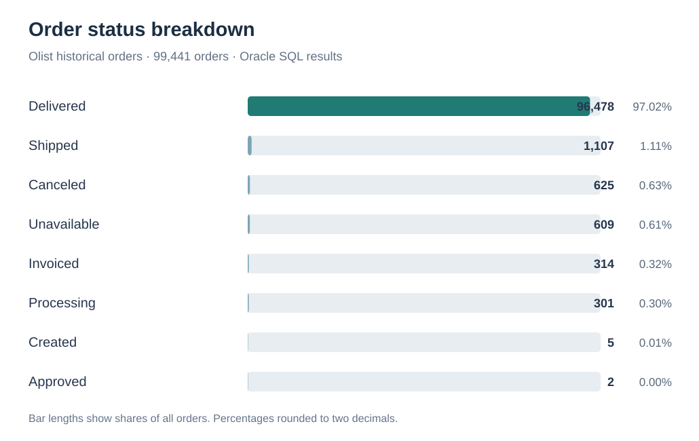
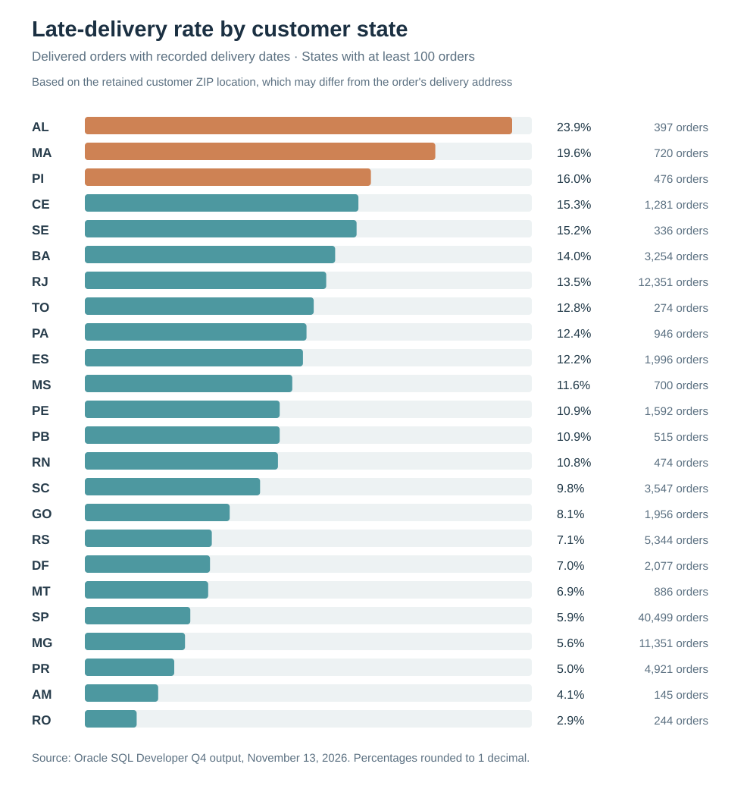
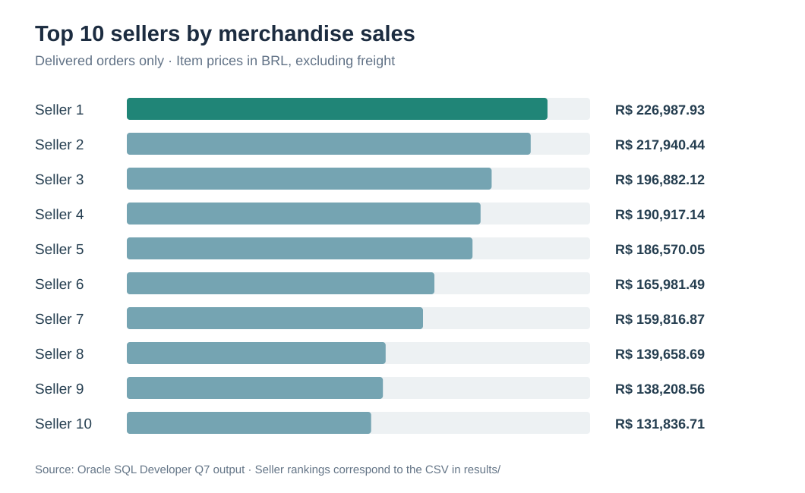

# Olist E-Commerce Customer Analytics — Findings Report

**Progress:** Q1–Q7 have been checked against Oracle outputs. Q8–Q10 are still pending.

## What I set out to learn

I wanted to see what the order data could tell me about customer experience and shopping habits. I started with delivery delays and reviews, then looked at repeat customers, product sales, and sales over time. I will add the remaining regional, seller, and payment analyses as I complete them.

## Reproducibility checklist

- [x] Run `01_schema.sql` and `02_staging_tables.sql`
- [x] Import eight prepared CSV datasets into staging tables (counts reconciled in the data quality report)
- [x] Run `03_load.sql`; final-table row counts reconciled against staging-derived expectations
- [x] Check orphaned foreign keys and unexpected nulls (see `data_quality_report.md`; eight delivered-status records missing delivery dates flagged)
- [ ] Execute all ten queries from `04_queries.sql`
- [ ] Finish exporting and documenting the remaining query results (Q1, Q5, Q6; Q2 CSV compared in Python)
- [x] Record query result dates and analytical limitations for completed questions (remaining queries pending)

## Q5 — Relationship Between Delivery Performance and Customer Satisfaction

**Question:** Do orders delivered later than their estimated delivery dates receive lower customer review scores?

**How I checked it:** Using Oracle SQL, delivered orders were classified as either late or on time by comparing their actual delivery timestamps with their estimated delivery timestamps. Orders without the required delivery dates or customer reviews were excluded. For orders with multiple reviews, the review scores were averaged to ensure each order contributed only once to the analysis. The reproducible query is [Q5 in `oracle/04_queries.sql`](../oracle/04_queries.sql).

**Results:** A total of **95,824 orders** were analyzed.

| Delivery status | Orders analyzed | Average review score (1–5) |
|---|---:|---:|
| Late | 7,661 | 2.57 |
| On Time | 88,163 | 4.29 |
| **Total** | **95,824** | **-** |

**What I found:** On-time deliveries received an average review score **1.72 points higher** than late deliveries, based on the rounded group averages (**4.29 − 2.57 = 1.72**). Approximately **7.99%** of the included orders were late (**7,661 ÷ 95,824 × 100**).

**Why it matters:** Delivery timing appears closely related to review scores in this sample. It would be worth looking more closely at shipping delays and whether the pattern holds across sellers and regions before recommending specific changes.

**Limitations:** This analysis demonstrates an association rather than a causal relationship. Other factors, including product quality, seller performance, and geographic location, may influence review scores. Additionally, the results apply only to reviewed, delivered orders with usable actual and estimated delivery timestamps. Multiple reviews for an order are averaged into one observation. The 1.72-point difference is calculated from group averages rounded to two decimals rather than from unrounded values.

## Q6 — Repeat Customer Behavior

**Business Question:** What percentage of unique Olist customers placed more than one order in the observed dataset?

**Methodology:** Group orders by `customer_unique_id` and count distinct `order_id` values per customer. Count a customer as a repeat customer if they placed more than one distinct order. Divide the repeat-customer count by the number of customers represented in the orders table. The reproducible query is [Q6 in `oracle/04_queries.sql`](../oracle/04_queries.sql).

| Total unique customers | Repeat customers (2+ orders) | Customers with 1 order | Observed repeat-purchase rate |
|---:|---:|---:|---:|
| 96,096 | 2,997 | 93,099 | **3.12%** |

**Key Finding:** **2,997 out of 96,096** unique customers placed more than one order (**2,997 ÷ 96,096 × 100 ≈ 3.12%**). The other **93,099** customers placed one order in the recorded period.

**Business Implications:** Repeat purchases were uncommon within the data's observation window. Investigating repeat behavior by customer cohort or product category may help identify patterns, but no specific retention improvement is established by this descriptive result.

**Limitations:** This is the *observed repeat-purchase rate*, not a lifetime customer retention rate. The dataset has a limited historical window (2016–2018), and customers near the end of the period have less time to make another purchase. The measure counts orders, not purchased items, and does not establish why customers did or did not return.

## Q1 — Top Product Categories by Merchandise Sales

**Question:** Which product categories have the highest item-price sales total among delivered orders?

**Methodology:** Join `ORDER_ITEMS`, `ORDERS`, `PRODUCTS`, and `PRODUCT_CATEGORIES`. Restrict to orders whose status is `delivered`; group by translated product category; sum `ORDER_ITEMS.PRICE`; and count distinct orders per category. Rank by the sum of item prices and keep the top ten. Query: [Q1 in `oracle/04_queries.sql`](../oracle/04_queries.sql).

| Rank | Product category | Item-price sales total | Distinct orders |
|---:|---|---:|---:|
| 1 | health_beauty | 1,233,131.72 | 8,647 |
| 2 | watches_gifts | 1,166,176.98 | 5,495 |
| 3 | bed_bath_table | 1,023,434.76 | 9,272 |
| 4 | sports_leisure | 954,852.55 | 7,530 |
| 5 | computers_accessories | 888,724.61 | 6,530 |
| 6 | furniture_decor | 711,927.69 | 6,307 |
| 7 | housewares | 615,628.69 | 5,743 |
| 8 | cool_stuff | 610,204.10 | 3,559 |
| 9 | auto | 578,966.65 | 3,810 |
| 10 | toys | 471,286.48 | 3,804 |

**What I found:** `health_beauty` has the largest item-price sales total, while `bed_bath_table` has more distinct orders (9,272 versus 8,647) but a smaller sales total. The category ranking therefore differs from a simple order-count ranking.

**Why it matters:** Some categories earn more in item sales even with fewer orders. That's a useful starting point for looking at category mix, but it doesn't tell us which products are most profitable.

**Limitations:** These values sum item prices only; freight, discounts, returns, fees, and costs are not comprehensively modeled. They are not net revenue, gross merchandise value including freight, or profit. One order containing multiple categories can appear in more than one category's distinct-order count. The query is restricted to orders labeled `delivered`, not all historical orders.

## Q2 — Monthly Orders and Merchandise Sales (Source CSV Cross-check)

**Status:** Verified. The 24 monthly Oracle rows supplied from SQL Developer matched the existing chart dataset in a pandas comparison (`Q2 VALIDATION: PASS`).

**Business question:** How do order counts and item-price sales vary by purchase month?

**Methodology:** Join `olist_orders_dataset.csv` to `olist_order_items_dataset.csv` by `order_id`. Group by the month of `order_purchase_timestamp`, count distinct orders with at least one order item, and sum `price` (excluding freight). This replicates the join and aggregations in [Q2 of `oracle/04_queries.sql`](../oracle/04_queries.sql). The chart's 24 monthly rows were compared with the values exported from Oracle; month, order count, and item-price sales matched for every row.

[Download the 24-row monthly results CSV](q2_monthly_sales.csv)

**What I found:** November 2017 had the highest monthly item-price sales in the comparison: **7,451** distinct orders and **BRL 1,010,271.37** in summed item prices. The totals used for the chart matched the Oracle export for all 24 months.

**Limitations:** Item-price sales exclude freight and do not represent net profit or verified accounting revenue. Orders without items are excluded by the inner join. Coverage of September 2016 and September 2018 is sparse, and months in the historical dataset are not necessarily complete. Month-by-month variation alone does not establish seasonality or business drivers.

## Q3 — What happened to the orders?

**Question:** How many orders were delivered, shipped, canceled, or left in another status?

**How I checked it:** I grouped the `ORDERS` table by `STATUS`, counted the orders in each group, and used an Oracle window function to calculate each group's share of all orders. The SQL is in [Q3 of `oracle/04_queries.sql`](../oracle/04_queries.sql). I checked the results against the Oracle SQL Developer output on November 13, 2026.

| Order status | Orders | Share of all orders |
|---|---:|---:|
| delivered | 96,478 | 97.02% |
| shipped | 1,107 | 1.11% |
| canceled | 625 | 0.63% |
| unavailable | 609 | 0.61% |
| invoiced | 314 | 0.32% |
| processing | 301 | 0.30% |
| created | 5 | 0.01% |
| approved | 2 | 0.00% |
| **Total** | **99,441** | **100%** |

**What I found:** Most orders (**97.02%**) are marked as delivered. The remaining **2,963 orders (2.98%)** fall into other statuses, with `shipped` the largest of those groups. The percentages are rounded individually, so the displayed values may not add to exactly 100%.

**Why it matters:** The status breakdown gives a useful starting picture of how far orders progressed through fulfillment. I would look more closely at orders marked shipped, unavailable, and canceled before drawing conclusions about operational problems. The historical snapshot does not show how long an order stayed in its status.

**Limitations:** Order status is not a complete measure of successful delivery or fulfillment time. Earlier data-quality checks found **eight orders marked delivered with missing actual delivery timestamps**. I also can't infer whether orders in other statuses were eventually completed after the dataset ended.

## Q4 — Where were late deliveries more common?

**Question:** Which customer-location states had the highest share of late deliveries?

**How I checked it:** I joined `ORDERS`, `CUSTOMERS`, and `LOCATIONS` and grouped the results by the state attached to each customer's retained ZIP prefix. I kept orders marked `delivered` with a recorded actual delivery timestamp, then calculated the percentage whose actual delivery date was later than the estimated date. The query includes only state groups with at least 100 eligible orders. I reviewed the Oracle SQL Developer output on November 13, 2026. The project query appears in [`oracle/04_queries.sql`](../oracle/04_queries.sql).

[CSV of the 24 displayed state results](q4_late_delivery_by_state.csv)

| State | Eligible delivered orders | Late (%) |
|---|---:|---:|
| AL | 397 | 23.9 |
| MA | 720 | 19.6 |
| PI | 476 | 16.0 |
| CE | 1,281 | 15.3 |
| SE | 336 | 15.2 |
| BA | 3,254 | 14.0 |
| RJ | 12,351 | 13.5 |
| TO | 274 | 12.8 |
| PA | 946 | 12.4 |
| ES | 1,996 | 12.2 |
| MS | 700 | 11.6 |
| PE | 1,592 | 10.9 |
| PB | 515 | 10.9 |
| RN | 474 | 10.8 |
| SC | 3,547 | 9.8 |
| GO | 1,956 | 8.1 |
| RS | 5,344 | 7.1 |
| DF | 2,077 | 7.0 |
| MT | 886 | 6.9 |
| SP | 40,499 | 5.9 |
| MG | 11,351 | 5.6 |
| PR | 4,921 | 5.0 |
| AM | 145 | 4.1 |
| RO | 244 | 2.9 |

**What I found:** Among the **24 states** meeting the minimum order count, Alagoas (AL) had the highest measured late-delivery rate at **23.9%** across **397** eligible orders, followed by Maranhão (MA) at **19.6%** and Piauí (PI) at **16.0%**. São Paulo (SP) had a **5.9%** rate across **40,499** eligible orders. These are descriptive differences, not proof of why delivery outcomes varied.

**Why it matters:** The rate-based comparison shows which groups are worth investigating next. However, a state with a high percentage and a small number of orders may have fewer delayed orders overall than a more populous state with a lower rate. A follow-up analysis could compare both rates and counts, and check whether patterns vary by seller or delivery distance.

**Limitations:** The normalized `CUSTOMERS` table retains one ZIP prefix per unique customer, chosen from their latest order. It cannot reliably recover the actual shipping state for each historical order, so **these are customer-location groupings, not exact order-destination results**. The analysis excludes orders not marked delivered, orders without an actual delivery timestamp, and groups with fewer than 100 eligible orders. Percentages are rounded to one decimal in the exported screenshot; exact late-order counts are not included in that output.

## Q7 — Which sellers generated the most merchandise sales?

**Question:** Which sellers have the highest delivered-order item-price sales, and how did customers review orders involving them?

**How I checked it:** I summed item prices for delivered orders by seller, counted distinct orders, and ranked sellers by sales total. To avoid giving orders with several items extra influence, I first averaged multiple reviews within each order, then averaged across distinct reviewed orders associated with each seller. I ran the corrected query in Oracle SQL Developer on November 13, 2026. The SQL is available in [`oracle/04_queries.sql`](../oracle/04_queries.sql).

[Download the corrected Q7 results](q7_top_sellers_verified.csv)

| Rank | Item-price sales (BRL) | Delivered orders | Reviewed orders | Average review |
|---:|---:|---:|---:|---:|
| 1 | 226,987.93 | 1,124 | 1,116 | 4.15 |
| 2 | 217,940.44 | 348 | 346 | 4.19 |
| 3 | 196,882.12 | 1,772 | 1,753 | 3.85 |
| 4 | 190,917.14 | 578 | 574 | 4.37 |
| 5 | 186,570.05 | 973 | 967 | 3.50 |
| 6 | 165,981.49 | 319 | 318 | 4.36 |
| 7 | 159,816.87 | 1,311 | 1,305 | 4.18 |
| 8 | 139,658.69 | 1,145 | 1,137 | 4.27 |
| 9 | 138,208.56 | 910 | 902 | 4.01 |
| 10 | 131,836.71 | 1,261 | 1,253 | 4.20 |

**What I found:** The top seller generated **BRL 226,987.93** in item-price sales across **1,124** delivered orders. Of those, **1,116** had usable review data, with an average score of **4.15 out of 5**. The fourth-ranked seller had the highest mean review score (**4.37**) among these ten sellers, despite ranking fourth in merchandise sales.

**Why it matters:** Higher sales do not automatically mean higher customer review scores. Looking at both metrics gives a broader picture of seller-related outcomes, although these results alone cannot tell us why one seller performs better than another.

**Limitations:** Reviews belong to whole orders rather than individual sellers. A review may therefore be associated with more than one seller when an order contains items from multiple sellers. Item-price sales exclude freight and costs; they are not profit. Seller identifiers are anonymized, and the ranking includes delivered orders only.

**Validation note:** I initially ran a query that repeated reviews for orders with multiple items and could include reviews outside the delivered-order group. The corrected query uses one observation per reviewed order per seller and restricts the reviewed orders to the delivered-only cohort. The [original result export](q7_top_sellers_initial.csv) is retained for comparison, but its review averages should not be used.

## Other analyses

| Query | Business question | Verified output |
|---|---|---|
| Q8 | Payment mix | Pending |
| Q9 | Average delivery time by state | Pending |
| Q10 | Lowest-rated categories | Pending |

## What I would investigate next

The strongest pattern so far is the gap in review scores between on-time and late deliveries. I'd like to see whether it holds across sellers, product categories, and locations. The repeat-purchase finding also deserves a closer look by first-order month, since customers had different amounts of time to return. I'll hold off on firm business recommendations until the remaining queries are complete.

## Data source

[Olist Brazilian E-Commerce Public Dataset](https://www.kaggle.com/datasets/olistbr/brazilian-ecommerce).
